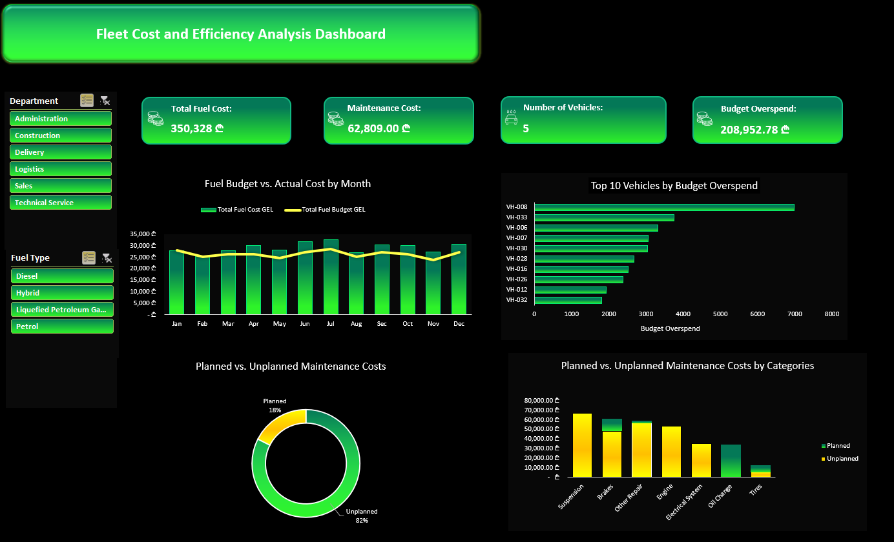
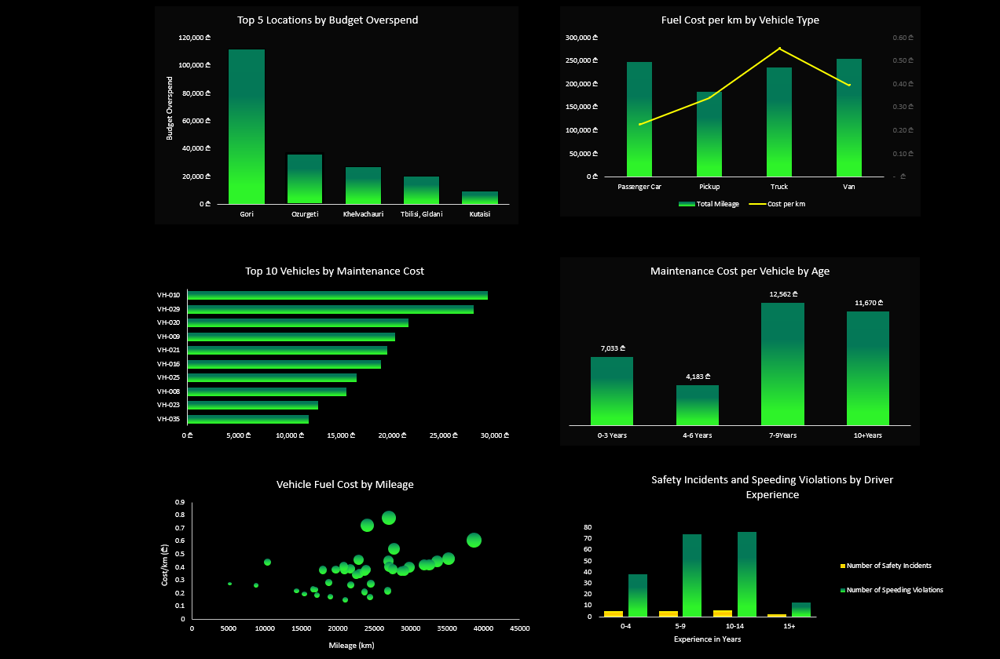
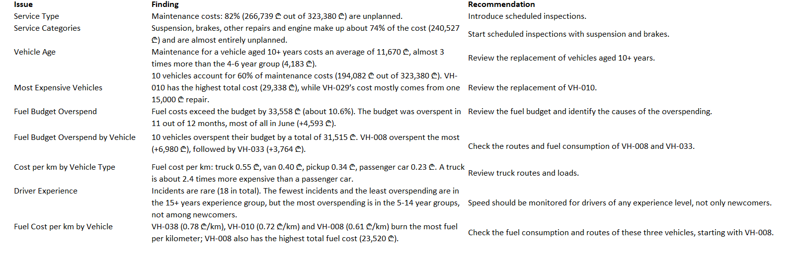

# Fleet Cost and Efficiency Analysis

Excel dashboard for analyzing fleet operational expenses.

## Business Question
Where is the fleet budget being spent the most (fuel, maintenance, facilities), and what measures should management take to reduce expenses?

## Dashboard

## Key Findings and Recommendations

1. **Unplanned Maintenance:** 82% of maintenance costs (266,739 GEL out of 323,380 GEL) are unplanned. Recommendation: Schedule preventive inspections for suspension and brakes.
2. **Older Vehicles:** Maintenance for vehicles 10+ years old costs an average of 11,670 GEL—nearly 3 times more than the 4–6 year age group (4,183 GEL). Recommendation: Consider replacements, starting with VH-010.
3. **Facility Budgets:** Total expenses exceed the budget by 208,953 GEL (approximately 16%), with Gori accounting for 111,835 GEL of that overrun. Recommendation: Audit Gori’s expenditures.

## Tools Used
Microsoft Excel: PivotTables, Data Model, DAX measures, PivotCharts, Power Query.

## Files
- `fleet-cost-analysis.xlsx`: Dashboard, Insights, Cleaned Tables
